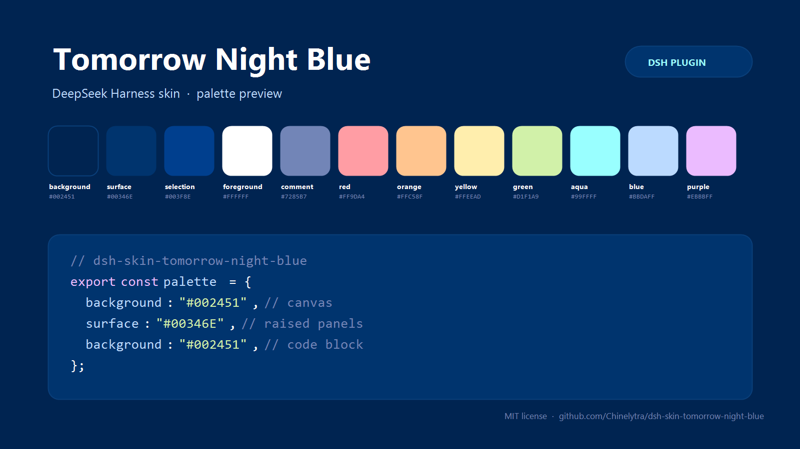

# dsh-skin-tomorrow-night-blue

**Tomorrow Night Blue skin for the [DeepSeek Harness](https://github.com/deepseek-ai/deepseek-harness) (DSH) Web GUI.**

[](https://github.com/Chinelytra/dsh-skin-tomorrow-night-blue/releases)
[](LICENSE)
[](https://github.com/topics/dsh-plugin)
[](https://github.com/deepseek-ai/deepseek-harness)

English | [中文](README.zh.md)



One skin, the whole interface: the classic deep-blue **Tomorrow Night Blue**
palette (Chris Kempson's [Tomorrow Theme](https://github.com/chriskempson/tomorrow-theme))
mapped onto DSH's design tokens and code-highlighting colors — canvas, sidebar,
panels, menus, buttons, conversation bubbles, markdown, diffs, scrollbars, focus
ring, and syntax highlighting in code blocks.

> Unofficial community skin. Not affiliated with DeepSeek.

## Install

Install into the profile that runs your GUI — `web` for `dsh --profile web`,
`desktop` for the DSH Desktop app.

**From GitHub:**

```sh
dsh plugin --profile web add github:Chinelytra/dsh-skin-tomorrow-night-blue
```

**From the release tarball** (prebuilt, no build step):

```sh
dsh plugin --profile web add https://github.com/Chinelytra/dsh-skin-tomorrow-night-blue/releases/latest/download/dsh-skin-tomorrow-night-blue.tgz
```

**From a local checkout:**

```sh
dsh plugin --profile web add link:/absolute/path/to/dsh-skin-tomorrow-night-blue
```

DSH applies profile changes live; if the palette does not appear immediately,
restart DSH once (the browser half loads with the app shell).

## What it does

- **113 `--dsw-alias-*` design tokens** — application canvas, raised layers,
  overlays, borders, labels, brand/link/button colors, interactive and state
  colors, markdown, diff, file-diff, scrollbar, focus ring, toast, tooltip, menu
  and product-specific surfaces (sidebar, bubble, composer, selector, tips).
- **11 Shiki syntax roles** — comments, keywords, strings, numbers/constants,
  functions, parameters, punctuation and links in fenced code blocks match the
  theme instead of keeping the stock Shiki palette.
- **First paint is already blue** — the host half injects the same declarations
  into every served `index.html` through the webserver's structured
  `index-inject` rows, so a browser page does not flash the default palette
  while its scripts load.
- **No dependencies, no network, no settings namespace** — one stylesheet and
  one token layer; disable or remove the bundle to get the stock look back.

## Palette

| Role | Color | | Role | Color |
| --- | --- | --- | --- | --- |
| Background | `#002451` | | Red | `#FF9DA4` |
| Current line / raised surface | `#00346E` | | Orange | `#FFC58F` |
| Selection / nested surface | `#003F8E` | | Yellow | `#FFEEAD` |
| Foreground | `#FFFFFF` | | Green | `#D1F1A9` |
| Comment | `#7285B7` | | Aqua | `#99FFFF` |
| | | | Blue | `#BBDAFF` |
| | | | Purple | `#EBBBFF` |

Tomorrow Night Blue has no official light counterpart, so the skin keeps this
palette in both appearance modes and aligns the appearance setting to dark on
first use.

## How it works

This is a two-half DSH plugin (all standard DSH plugin metadata, no custom
wiring):

| Half | File | Role |
| --- | --- | --- |
| Host | `index.js` | Pushes one structured `style` row into `webserver/index-inject` so served pages paint the skin before scripts run. |
| Client | `lib/client.js` | Appends one `<style>` element with the token + Shiki declarations and registers it with the app's `__ModuleLoader__` bundle format. |

`src/palette.mjs` is the single source of truth: a 15-anchor palette expanded
into the `--dsw-alias-*` surface. `build-client.mjs` serializes that derivation
into the browser bundle; `verify.mjs` re-derives it offline and exercises both
halves against stubs.

The declarations are `!important` on purpose: DSH's layout presenter writes the
composed alias tokens as **inline** custom properties on `<body>`, and only an
important stylesheet declaration outranks inline style. A fixed skin must win
that cascade; a theme that wants to stay configurable should use the
`ctx.theme.overrideTokens` layer instead.

## Compatibility

- DSH Web GUI **0.2.x** (developed and tested against `0.2.2-rc.1`, DSH
  Desktop profile; the same client bundle serves `dsh --profile web`).
- Node.js `>=20` for the build/verify scripts (runtime needs no build).
- While enabled, the skin's `!important` layer takes precedence over token
  layers from other skin plugins (for example `dsh-opencode-palette`). Disable
  this bundle to hand the cascade back to them.

## Disable / uninstall

- **Settings → Plugins** → turn off or remove `dsh-skin-tomorrow-night-blue`.
- CLI: `dsh plugin --profile <profile> remove dsh-skin-tomorrow-night-blue`

## Development

```sh
node build-client.mjs   # regenerate lib/client.js from src/palette.mjs
node verify.mjs         # offline checks: palette, host injection, bundle load
```

`verify.mjs` requires no DSH runtime: it derives the token surface, calls the
host `apply` with a fake context and a captured injection table, then loads the
built bundle through the real `window.__ModuleLoader__` factory shape against a
DOM stub.

## License & attribution

MIT © Chinelytra. See [LICENSE](LICENSE).

The palette is transcribed from **Tomorrow Theme** by Chris Kempson
([chriskempson/tomorrow-theme](https://github.com/chriskempson/tomorrow-theme),
MIT). This repository is an independent DSH skin and is not affiliated with or
endorsed by the Tomorrow Theme project or DeepSeek.
