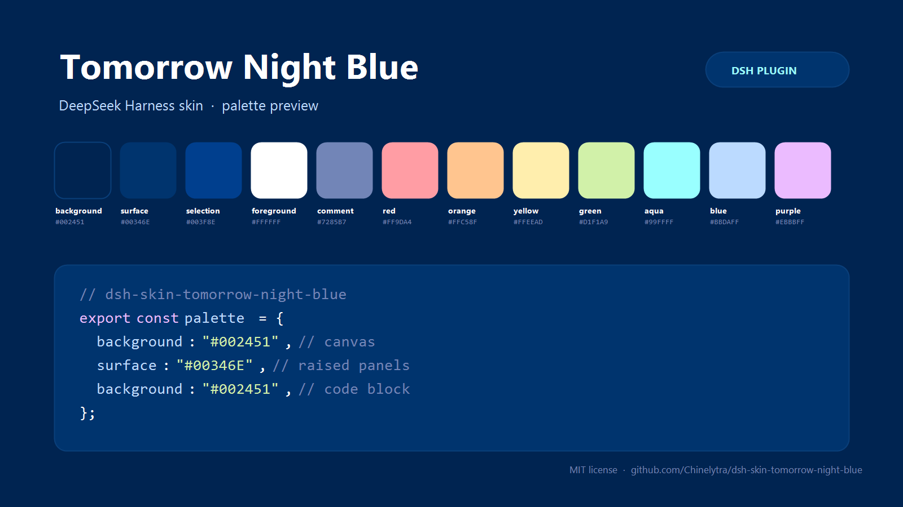

# dsh-skin-tomorrow-night-blue

**DeepSeek Harness（DSH）Web GUI 的 Tomorrow Night Blue 深蓝皮肤。**

[](https://github.com/Chinelytra/dsh-skin-tomorrow-night-blue/releases)
[](LICENSE)
[](https://github.com/topics/dsh-plugin)

[English](README.md) | 中文



一套皮肤覆盖整个界面：把 Chris Kempson
[Tomorrow Theme](https://github.com/chriskempson/tomorrow-theme) 里的经典深蓝配色
**Tomorrow Night Blue** 映射到 DSH 的设计令牌与代码高亮色上——画布、侧栏、面板、
菜单、按钮、对话气泡、Markdown、diff、滚动条、焦点环，以及代码块的语法高亮。

> 非官方社区皮肤，与 DeepSeek 官方无关。

## 安装

装进正在运行 GUI 的那个 profile：命令行版用 `web`，桌面版用 `desktop`。

```sh
# 从 GitHub 安装
dsh plugin --profile web add github:Chinelytra/dsh-skin-tomorrow-night-blue

# 或从 Release 预构建 tarball 安装（无需构建）
dsh plugin --profile web add https://github.com/Chinelytra/dsh-skin-tomorrow-night-blue/releases/latest/download/dsh-skin-tomorrow-night-blue.tgz

# 或本地目录
dsh plugin --profile web add link:/绝对路径/dsh-skin-tomorrow-night-blue
```

DSH 会即时应用 profile 变更；若配色未立刻出现，重启一次 DSH 即可（浏览器半随
应用外壳加载）。

## 覆盖范围

- **113 个 `--dsw-alias-*` 设计令牌**：画布、浮层、边框、文字、品牌/链接/按钮、
  交互态与状态色、Markdown、diff、文件 diff、滚动条、焦点环、toast、tooltip、
  菜单，以及侧栏/气泡/输入框/选择器/提示条等产品面。
- **11 个 Shiki 语法角色**：代码块里的注释、关键字、字符串、数字/常量、函数、
  参数、标点与链接，不再沿用默认色。
- **首帧即深蓝**：宿主半把同一套声明以结构化 `style` 行注入到每个
  `index.html`，浏览器页面在脚本加载前就已是皮肤配色，不闪默认色。
- **零依赖、零网络、零设置命名空间**：一层样式 + 一层令牌；停用或移除 bundle
  即可回到官方外观。

## 配色

背景 `#002451` · 当前行/浮层 `#00346E` · 选区/嵌套面 `#003F8E` · 正文 `#FFFFFF`
· 注释 `#7285B7` · 红 `#FF9DA4` · 橙 `#FFC58F` · 黄 `#FFEEAD` · 绿 `#D1F1A9`
· 青 `#99FFFF` · 蓝 `#BBDAFF` · 紫 `#EBBBFF`。

Tomorrow Night Blue 没有官方浅色版本，因此两种外观模式下都保持这套深蓝，并在
首次使用时把外观对齐为深色。

## 实现

| 半 | 文件 | 作用 |
| --- | --- | --- |
| 宿主 | `index.js` | 通过 `webserver/index-inject` 注入一条结构化 `style` 行，服务端 HTML 首帧即带皮肤。 |
| 浏览器 | `lib/client.js` | 以 DSH 的 `__ModuleLoader__` bundle 格式追加一层 `<style>`（令牌 + Shiki 声明）。 |

`src/palette.mjs` 是唯一数据源：15 个语义锚点展开成整套 `--dsw-alias-*` 令牌；
`build-client.mjs` 把派生结果序列化进浏览器 bundle，`verify.mjs` 离线复验两半。

样式声明刻意使用 `!important`：DSH 的布局展示层会把合成后的别名令牌写成
`<body>` 的**内联**自定义属性，只有 important 的样式表声明才能压过内联样式。
固定皮肤必须赢下这一层；可配置主题应改用 `ctx.theme.overrideTokens` 令牌层。

## 兼容性

- DSH Web GUI **0.2.x**（在 `0.2.2-rc.1` 的 DSH Desktop profile 上开发与验证；
  同一浏览器 bundle 也适用于 `dsh --profile web`）。
- 构建/校验脚本需要 Node.js `>=20`（运行时不需要构建）。
- 启用期间，本皮肤的 `!important` 层优先于其它皮肤插件的令牌层（如
  `dsh-opencode-palette`）；想换回它们，停用本 bundle 即可。

### 已知限制

- 本皮肤覆盖的是**别名令牌**（外加 Shiki 语法角色）。DSH 中少数辅助界面用的是
  设计系统的**静态**令牌（例如部分文件变更/diff 卡片的标题栏保持中性深色底），
  因此仍按原主题绘制——这是所有令牌层皮肤的同一边界。
- Tomorrow Night Blue 是深色调色板；两种外观模式下都保持深蓝是刻意设计。

## 停用 / 卸载

- **设置 → 插件** 里关闭或移除 `dsh-skin-tomorrow-night-blue`；
- 或执行 `dsh plugin --profile <profile> remove dsh-skin-tomorrow-night-blue`。

## 开发

```sh
node build-client.mjs   # 由 src/palette.mjs 重新生成 lib/client.js
node verify.mjs         # 离线校验：调色板、宿主注入、浏览器 bundle 加载
```

## 许可与致谢

MIT © Chinelytra，见 [LICENSE](LICENSE)。

配色取自 Chris Kempson 的 **Tomorrow Theme**
（[chriskempson/tomorrow-theme](https://github.com/chriskempson/tomorrow-theme)，
MIT）。本项目是独立的 DSH 皮肤，与 Tomorrow Theme 项目及 DeepSeek 均无隶属或
背书关系。
